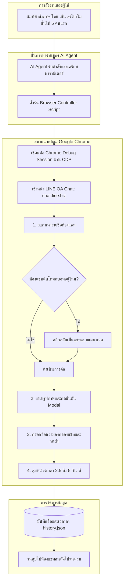

# Workflow ส่งข้อความและรูปภาพใน LINE Official Account Chat อัตโนมัติด้วย AI Agent


บทความนี้สรุปแนวทางการสร้างระบบช่วยส่งข้อความและรูปภาพหาลูกค้าใน LINE Official Account Chat (chat.line.biz) ทีละห้องแบบอัตโนมัติ โดยที่คุณไม่ต้องเขียนโค้ดเอง เพียงใช้ AI Agent เข้ามาช่วยสร้างและควบคุมการทำงานทั้งหมดผ่านการสั่งงานด้วยข้อความภาษาไทย

---

## ปัญหาที่พบจากการทำงานจริง

สำหรับคนที่ดูแล LINE Official Account (LINE OA) ของร้านค้าหรือธุรกิจ มักจะเจอปัญหาคล้ายกันอยู่ 2 เรื่อง:

1. **การ Broadcast ปกติมีต้นทุนและไม่ตรงกลุ่ม:** การบรอดแคสต์แบบเดิมมีโควต้าจำกัด หากเกินแพ็กเกจจะมีค่าบริการเพิ่มตามจำนวนผู้รับ และข้อความมักมีลักษณะเป็นโฆษณาทั่วไป ลูกค้าส่วนใหญ่จึงมักจะมองข้าม
2. **การทักแชท 1-on-1 ด้วยมือใช้เวลามากเกินไป:** เวลาเรามีโปรโมชั่นพิเศษหรืออยากแจ้งข่าวสารลูกค้าประจำทีละคน การนั่งเปิดทีละห้องแชท แนบรูป พิมพ์ข้อความเดิมซ้ำๆ และต้องคอยกดเปลี่ยนสถานะจากระบบตอบรับอัตโนมัติมาเป็นแชทด้วยตนเอง เป็นงานที่เสียเวลาและเสี่ยงต่อการส่งซ้ำหรือส่งผิดคน

แนวทางแก้ไขคือการให้ AI Agent เข้ามาควบคุม Google Chrome ที่เราล็อกอินไว้แล้ว เพื่อช่วยเปิดห้องแชท ตรวจสอบสถานะห้อง แนบรูปภาพ กรอกข้อความ และกดส่งให้ตามลำดับที่เราต้องการ

---

## แผนภาพการทำงานของระบบ (Workflow Diagram)



---

## ขั้นตอนการ Prompt สั่ง AI Agent ให้สร้างระบบ

คุณสามารถนำชุดคำสั่ง (Prompt) ด้านล่างนี้ไปวางใน AI Coding Assistant (เช่น Claude Code, Antigravity, Cursor หรือเครื่องมือประเภท Agent ที่คุณใช้งานอยู่) ตามลำดับ 2 ขั้นตอน

---

### ขั้นที่ 1: สั่ง AI ให้เตรียม Google Chrome ที่จำการล็อกอิน

การทำงานกับ LINE OA สิ่งสำคัญคือต้องไม่เปิดเบราว์เซอร์ใหม่แบบไม่จำข้อมูล เพราะจะทำให้ต้องสแกนคิวอาร์โค้ดหรือติดรหัสยืนยันทุกครั้ง เราจึงต้องให้ AI เตรียมสคริปต์เปิด Chrome ในโหมด Remote Debugging และระบุโฟลเดอร์เก็บโปรไฟล์ไว้

**Prompt สำหรับขั้นที่ 1:**

```text
ช่วยสร้าง Shell Script สำหรับเปิด Google Chrome ในโหมด Remote Debugging เพื่อใช้ทำงานกับเว็บ LINE Official Account Chat (https://chat.line.biz) โดยมีรายละเอียดดังนี้:

1. กำหนด Port สำหรับ Debug เช่น 9333 หรือ 9222
2. กำหนดโฟลเดอร์เก็บ User Data Profile แยกไว้ต่างหาก เพื่อให้จำ Session การล็อกอินของ LINE OA ไว้ตลอด ไม่ต้องล็อกอินใหม่ทุกครั้งที่เปิด
3. ใส่ระบบตรวจสอบว่า ถ้า Chrome ในพอร์ตนี้เปิดทำงานอยู่แล้ว ให้แจ้งเตือนและสลับไปที่แท็บแชท โดยไม่ต้องเปิดหน้าต่างใหม่ซ้ำ
```

เมื่อ AI สร้างและรันสคริปต์นี้แล้ว หน้าต่าง Google Chrome จะเปิดขึ้นมา **ให้คุณเข้าสู่ระบบ LINE OA** ของคุณให้เรียบร้อย ทำเพียงครั้งเดียวเบราว์เซอร์จะจำสถานะไว้ตลอดไป

---

### ขั้นที่ 2: สั่ง AI ให้สร้างระบบส่งแชทและคุมความปลอดภัย (Master Prompt)

เมื่อล็อกอินเสร็จ ให้คัดลอกคำสั่งด้านล่างนี้ส่งให้ AI เพื่อสร้างตรรกะการทำงานอัตโนมัติ

**Prompt สำหรับขั้นที่ 2:**

```text
ช่วยเขียนสคริปต์ Automation ด้วย Playwright (Node.js) เพื่อเชื่อมต่อไปยัง Google Chrome ที่เปิดค้างไว้ผ่าน CDP แล้วทำงานกับหน้าแชท LINE OA (chat.line.biz) ตามข้อกำหนดต่อไปนี้:

1. การเลือกผู้รับ:
   - สามารถระบุจำนวนผู้รับลำดับแรกๆ ได้ เช่น ส่งเฉพาะ 5 คนแรกบนสุด
   - สามารถระบุชื่อลูกค้าที่ต้องการส่งได้ เพื่อใช้ในการค้นหาและส่งเฉพาะบุคคล
   - สามารถสั่งส่งหาทุกคนในรายการแชทที่ยังไม่เคยได้รับข้อความได้

2. การจัดการหน้าต่างแชทของ LINE OA:
   - ถ้าห้องแชทอยู่ในโหมดตอบกลับอัตโนมัติ ให้ตรวจหาปุ่ม "แชทแบบแมนนวล" แล้วกดสลับโหมดทันที
   - หากมีไฟล์รูปภาพ ให้อัปโหลดเข้าช่อง input file และกดปุ่มยืนยันส่งในหน้าต่าง Popup Modal ให้เรียบร้อย
   - พิมพ์ข้อความลงในกล่องข้อความ (#editor textarea ที่อยู่ใน Shadow DOM) และสั่งส่งข้อความ

3. ความปลอดภัยและการควบคุมระบบ:
   - มีระบบสุ่มหน่วงเวลา 2.5 ถึง 5.0 วินาทีระหว่างการส่งแต่ละห้อง เพื่อเลียนแบบการใช้งานของมนุษย์ ป้องกันการถูกจำกัดการส่ง
   - มีระบบบันทึกประวัติการส่งลงไฟล์ JSON เพื่อป้องกันการส่งซ้ำหาคนเดิม หากระบบหยุดทำงานกลางคัน เมื่อเริ่มใหม่ต้องข้ามคนที่ส่งไปแล้วได้ทันที
   - มีตัวเลือก --dry-run สำหรับทดสอบการคลิกเลือกห้องแชทโดยไม่กดส่งข้อความจริง
```

---

## ตัวอย่างการสั่งงานในชีวิตประจำวัน (Daily Prompts)

เมื่อ AI สร้างโครงสร้างทั้งสองส่วนเสร็จแล้ว ในการใช้งานจริงคุณแค่เปิดแท็บ LINE OA ทิ้งไว้ แล้วพิมพ์สั่ง AI ด้วยข้อความตามงานที่ต้องการได้ทันที:

### 1. ทดลองส่งเฉพาะบุคคล (Test Run)

> "ช่วยส่งรูปเมนูใหม่ promo.jpg พร้อมข้อความ 'สิทธิพิเศษประจำสัปดาห์สำหรับสมาชิกคนพิเศษ...' ไปที่แชทชื่อ 'คุณสมชาย' เพื่อทดสอบระบบให้หน่อย"

### 2. ส่งด่วนหาลูกค้าล่าสุด (Top N)

> "ช่วยส่งรูปภาพ banner.png พร้อมข้อความ 'แจ้งโปรโมชั่นพิเศษ รับฟรีเครื่องดื่มเมื่อสั่งครบ 300 บาท' ให้ลูกค้า 3 คนแรกบนสุดใน LINE OA"

### 3. ส่งกระจายหาทุกคนที่ยังไม่เคยได้รับข้อความ (Broadcast All)

> "ช่วยส่งข้อความแจ้งกำหนดการเปิดปิดร้านช่วงวันหยุด พร้อมรูปตารางเวลา หาห้องแชททุกคนที่ยังไม่เคยได้รับข้อความนี้"

### 4. ตรวจสอบรายชื่อและสถานะ (Scan & Audit)

> "ช่วยสแกนรายชื่อห้องแชทใน LINE OA ให้ดูหน่อยว่ามีทั้งหมดกี่คน และมีใครที่ส่งข้อความไปแล้วบ้าง"

---

## ข้อควรระวังและแนวทางปฏิบัติที่ดี

- **ตั้งค่าหน่วงเวลาเสมอ:** การส่งข้อความอัตโนมัติควรมีการเว้นช่วงเวลาอย่างน้อย 2.5 ถึง 5 วินาทีต่อห้อง เพื่อให้หน้าเว็บโหลดข้อมูลทันและไม่ทำให้ระบบของ LINE มองว่าเป็นพฤติกรรมผิดปกติ
- **ทดสอบก่อนส่งจริงทุกครั้ง:** แนะนำให้ใช้โหมดระบุชื่อเฉพาะคน เพื่อทดลองส่งหาบัญชีของตนเองหรือทีมงานก่อน 1 รอบ เพื่อตรวจดูว่าข้อความและรูปภาพจัดวางสวยงามถูกต้อง
- **เว้นระยะความถี่ของแคมเปญ:** ควรเลือกส่งเฉพาะข้อมูลที่เป็นประโยชน์หรือโปรโมชั่นที่ตรงกับความต้องการของลูกค้า เพื่อรักษาความสัมพันธ์ที่ดีและป้องกันไม่ให้ลูกค้ากดบล็อก
